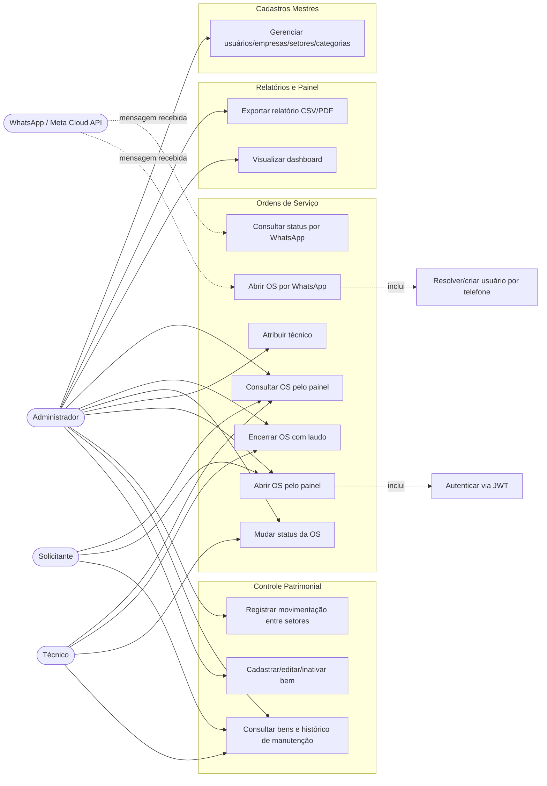
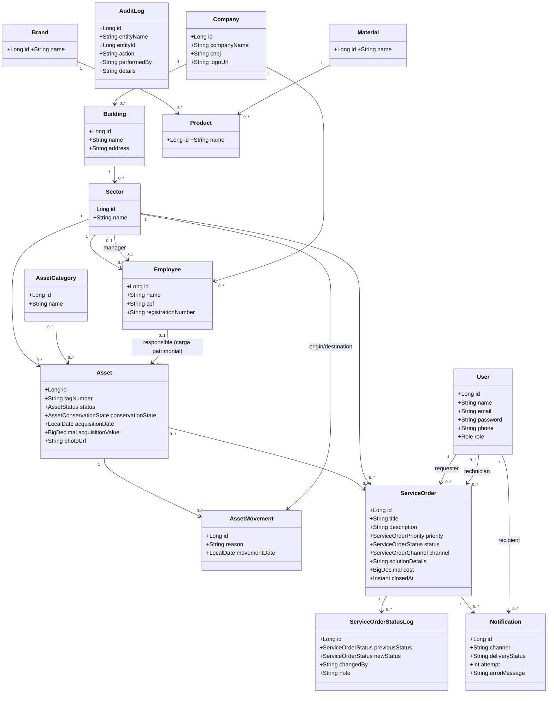
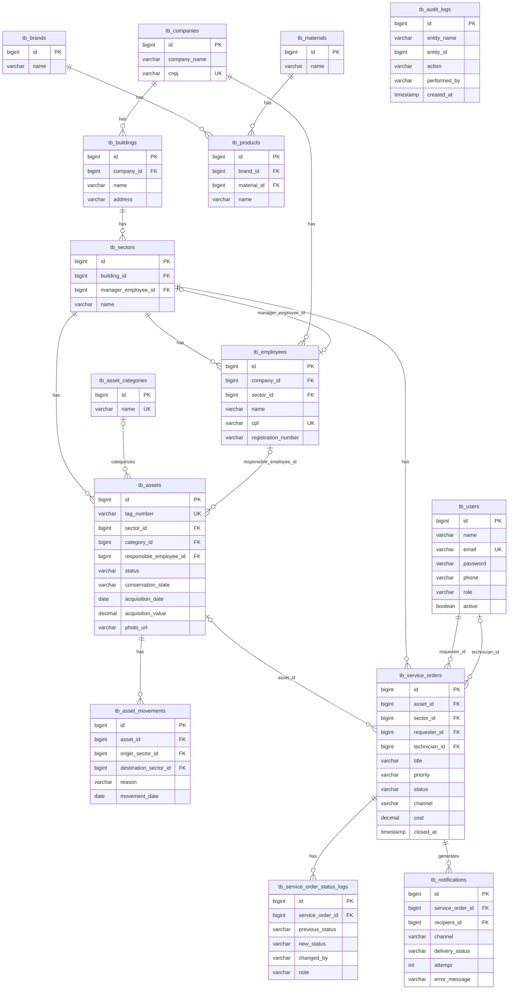
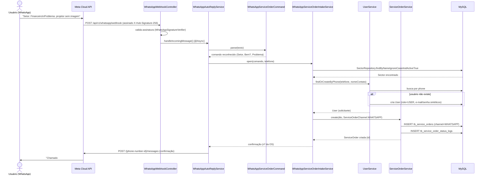

# Diagramas UML

> Exigido pelas diretrizes de TCC da FPO para a modalidade III (MVP): "documentação técnica: elaboração de [...] diagramas (incluindo UML) [...]" (`docs/apoio/Orientações de TCC para ADS -2026.pdf`). Os diagramas abaixo foram produzidos a partir do código efetivamente implementado (entidades em `src/main/java/br/com/fpo/sgc/domain/**`, migrações em `src/main/resources/db/migration/V1`–`V19`), não do desenho conceitual original do TCC — para a divergência entre os dois, ver `PLANO_IMPLEMENTACAO_MVP.md`, seção 0.1.
>
> Formato: [Mermaid](https://mermaid.js.org/), renderizado automaticamente pelo GitHub/GitLab ao visualizar este arquivo, e editável como texto (sem depender de ferramenta gráfica externa).

## 1. Diagrama de casos de uso

Mermaid não tem um tipo de diagrama nativo para caso de uso UML; a representação abaixo usa um grafo para mostrar quais atores acionam quais casos de uso, mantendo a semântica (ator → caso de uso, `<<include>>` para pré-condição).



**Notas de leitura**:
- `Solicitante` é qualquer usuário autenticado sem papel de administrador/técnico (`Role.USER`); quem abre OS pelo WhatsApp (UC05) não precisa de cadastro prévio — o usuário é resolvido/criado automaticamente pelo número de telefone (`UserService.findOrCreateByPhone`), daí a relação `<<include>>` com um caso de uso diferente do login tradicional.
- `UC09` (consultar status por WhatsApp) **não** cria usuário — telefone desconhecido recebe apenas "sem histórico" (ver `PLANO_IMPLEMENTACAO_MVP.md`, RF16).

## 2. Diagrama de classes (domínio)

Representa as entidades JPA efetivamente implementadas (`@Entity`) e seus relacionamentos. Atributos omitidos quando óbvios pelo nome; tipos de enum anotados entre parênteses. A maioria das entidades estende `BaseEntity` (`createdAt`, `updatedAt`, `active`), omitido em cada classe para não poluir o diagrama — exceções: `Company`, `Building` e `Brand` têm um `active` próprio (sem `createdAt`/`updatedAt`), e `AuditLog` não estende `BaseEntity`, mantendo apenas seu próprio `createdAt` (campo central de um log imutável, sem `updatedAt`/`active`).



## 3. Diagrama entidade-relacionamento (ER)

Simplificado ao nível de tabela/chave, refletindo o schema aplicado pelas migrações Flyway (`V1`–`V19`). Para a lista completa de colunas, consultar `src/main/resources/db/migration/`.



## 4. Diagrama de sequência — abertura de OS por WhatsApp (RF15)

Fluxo do diferencial central do produto: uma mensagem recebida vira uma Ordem de Serviço registrada no banco, sem exigir cadastro prévio do solicitante.



## 5. Diagrama de sequência — notificação com fallback WhatsApp → e-mail

Mecanismo de robustez: nenhuma mudança de status de OS fica sem notificar o envolvido, mesmo que o canal preferencial (WhatsApp) falhe.

```mermaid
sequenceDiagram
    participant OSSvc as ServiceOrderServiceImpl
    participant Spring as Spring Event Bus
    participant Listener as ServiceOrderNotificationListener
    participant Notif as NotificationServiceImpl
    participant WA as WhatsAppNotificationSender
    participant Email as EmailNotificationSender
    participant DB as MySQL (tb_notifications)

    OSSvc->>Spring: publica ServiceOrderEvent (RESOLVED, actorUserId)
    Note over OSSvc,Spring: publicado dentro da transação;<br/>listener só dispara após commit
    Spring->>Listener: @TransactionalEventListener(AFTER_COMMIT) [@Async]
    Listener->>Notif: notify(solicitante, mensagem, status)
    Notif->>WA: send(telefone, mensagem)
    alt WhatsApp indisponível (token expirado, fora da janela 24h, etc.)
        WA-->>Notif: falha (erro da Graph API)
        Notif->>DB: registra tentativa (channel=WHATSAPP, status=FAILED)
        Notif->>Email: send(email, mensagem, status)
        Email-->>Notif: sucesso
        Notif->>DB: registra tentativa (channel=EMAIL, status=SENT)
    else WhatsApp disponível
        WA-->>Notif: sucesso
        Notif->>DB: registra tentativa (channel=WHATSAPP, status=SENT)
    end
    Note over Notif: falha de notificação nunca propaga exceção<br/>para a operação de negócio que originou o evento
```
